<div align="center">

# 👋 hi-shell

**A Material 3 Expressive desktop shell for Hyprland — with AI built in.**

Built on [Quickshell](https://quickshell.org). Colors from your wallpaper, animations everywhere, English and Russian.

[](https://archlinux.org)
[](https://hyprland.org)
[](https://quickshell.org)
[](https://m3.material.io)
<br>
[](LICENSE)
[](https://t.me/hi_shell)

[Install](#installation) · [Screenshots](#screenshots) · [Shortcuts](#usage) · [Configuration](#configuration) · [Troubleshooting](#troubleshooting) · [Community](#community)

<br>

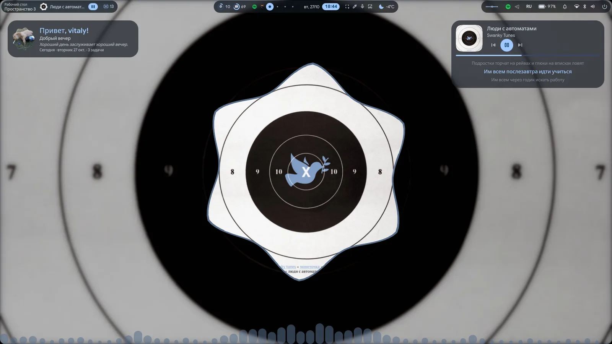

</div>

---

## Features

| | |
| --- | --- |
| 🧭 **Bar** | Configurable widgets (left / center / right), any screen edge, Hug / Float / Islands / M3 styles, hover popups for media, resources, weather, battery and updates, a live audio spectrum |
| 🚀 **App launcher** | Apps and settings, plus prefixes: `=` calculator (a plain "12*(3+4)" or "10+5=" is answered too, without the prefix), `>` run a command, `<` keybinds, `:` emoji, `;` clipboard (images with a preview), `/` settings |
| ✨ **AI** | Quick palette (<kbd>Super</kbd>+<kbd>Y</kbd>) and a full chat in the left sidebar: streamed answers, code blocks with copy buttons, model picker, token / cost usage, saved chats. Works with Claude (through the `claude` CLI) and other AI services: [OpenRouter](https://openrouter.ai) (the free models included), OpenAI, Gemini, Groq, DeepSeek, Mistral, a local Ollama, or any OpenAI-compatible server |
| 🪟 **Overlays** | Workspace overview with a tile and icon per window (drag windows between workspaces), session screen, polkit dialog, region screenshot / OCR / recording (with system sound or the microphone), optional dock, rounded screen corners |
| ⬅️ **Left sidebar** | Greeting, now playing with synced lyrics (and the cover blurred behind it, `appearance.coverBackdrop`, off in Settings → Interface), weather, AI chat, translator, clipboard history with image thumbnails |
| 🎯 **Focus Mode** | Sessions with a minimal bar, Pomodoro cycles, blocked apps and sites, profiles, statistics and achievements |
| ⏳ **Wait Mode** | A cover for the person while an AI works on the machine: a player or the wallpaper, keyboard and mouse shut out, no sleeping, Esc three times to exit; automation can still see and click what's underneath |
| 🔋 **Power saving** | One switch turns off animations, blur, transparency, the visualizer and the dancing frame, and puts them back when it's turned off |
| ➡️ **Right sidebar** | Quick toggles (Android-style pills or classic buttons, editable), volume / brightness / mic, Wi-Fi and Bluetooth pages, per-app volume, notification center, calendar, to-do, focus / stopwatch / countdown timers |
| 🖼️ **Desktop** | Shape clock, big clock, weather, resources, calendar, media with lyrics (click or drag its progress bar to seek), greeting, to-do, notes, world clock, timers, user card, image frame; audio visualizer; drag-to-place edit mode |
| 🎨 **Theming** | Wallpaper picker (local folders, Wallhaven, Unsplash), Material 3 palette from the wallpaper via matugen, scheme variants, light / dark / auto, shaped wallpaper frame |
| ⚙️ **Settings** | Every option in a settings app, Hyprland displays / gaps / blur / input included, searchable from the launcher |
| 🌍 **Languages** | English and Russian: the whole interface, dates and plural forms |
| 👋 **Welcome & presets** | A first-run setup, and presets that save your config, wallpaper and colors to one shareable file |

Animations run everywhere, yet the shell idles at about 1% CPU: hidden panels and disabled widgets aren't created,
and the audio spectrum is drawn by a single shader.

## Screenshots

| | |
| :---: | :---: |
| 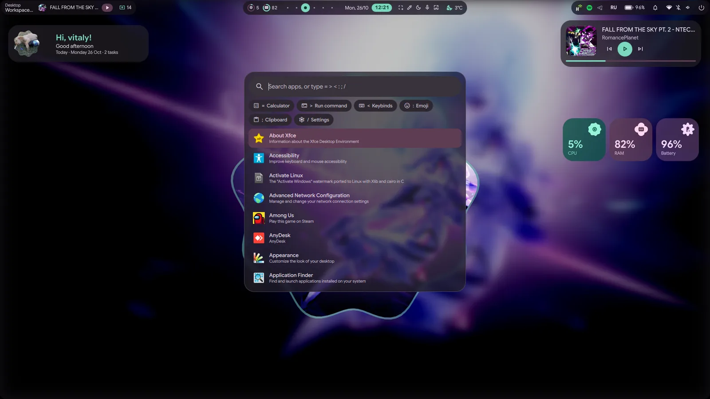 | 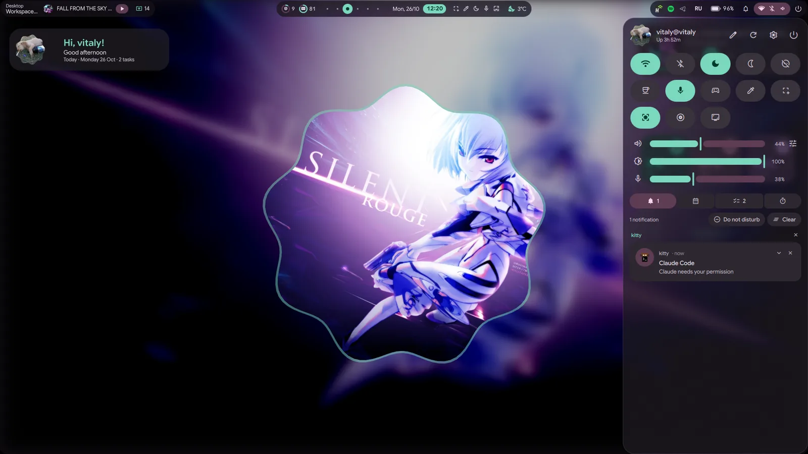 |
| **App launcher** — apps, settings, calculator, emoji, clipboard | **Right sidebar** — quick toggles, sliders, notifications |
| 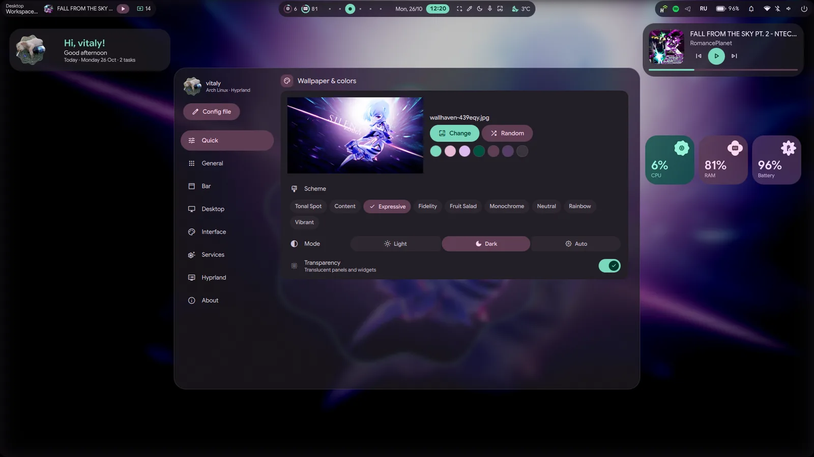 | 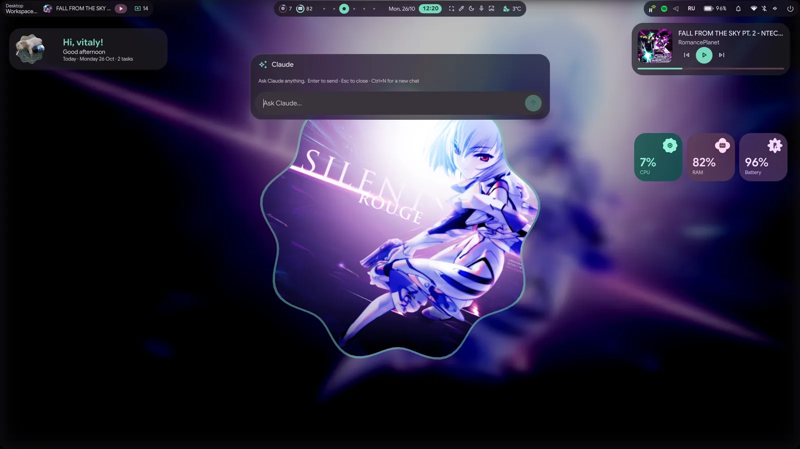 |
| **Settings** — every option, searchable from the launcher | **AI palette** — ask anything, answers stream in |
| 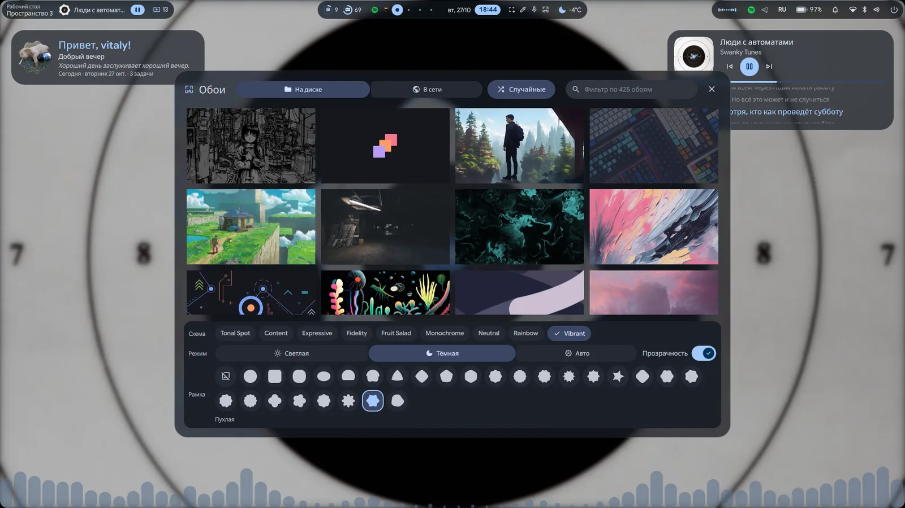 | 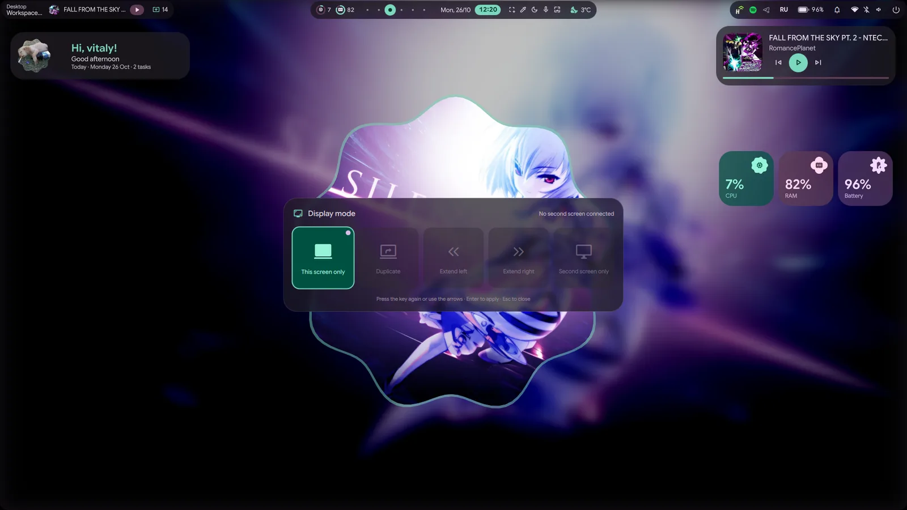 |
| **Wallpapers** — local and online, scheme, mode, 28 frames | **Display mode** — duplicate or extend to a second screen |
| 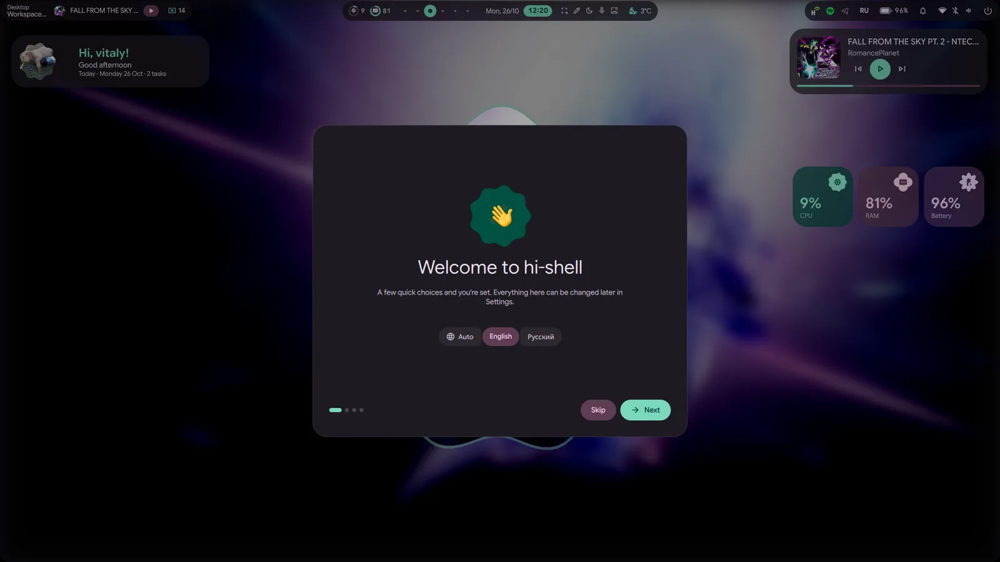 | 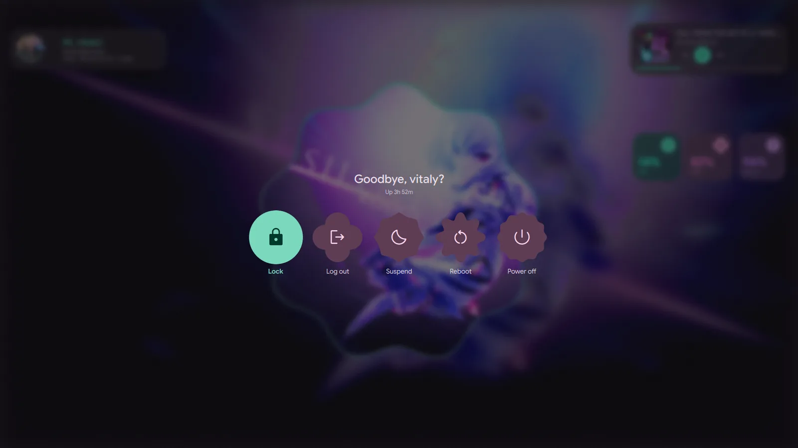 |
| **First-run welcome** — language, look and shortcuts | **Session screen** — lock, log out, suspend, reboot, power off |
| 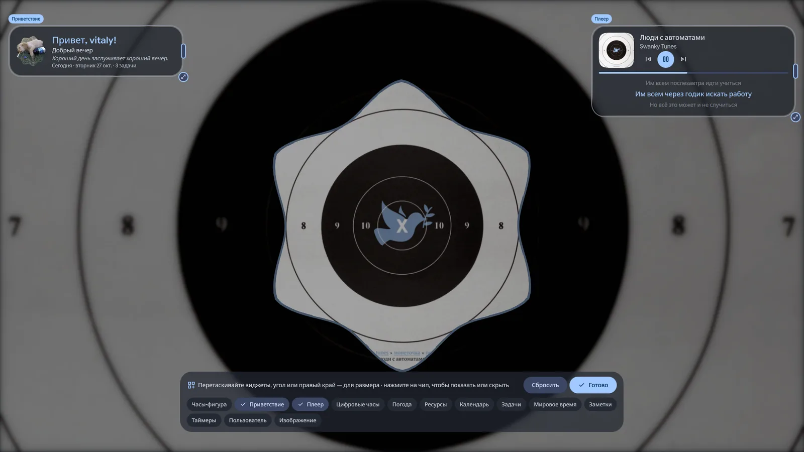 | 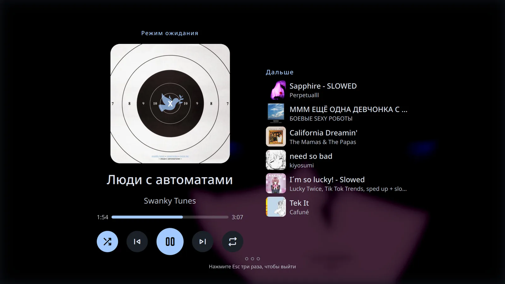 |
| **Desktop edit mode** — drag, scale and stretch widgets | **Wait Mode** — a locked screen with the player and the queue |

## Requirements

Arch Linux + Hyprland **0.56+** (the integration file uses the Lua config).

| Package | Used for |
| --- | --- |
| `quickshell-git` (AUR) | the shell itself (0.3+, with the Hyprland, Pipewire, Bluetooth and Networking modules) |
| `matugen` | Material 3 colors from the wallpaper |
| `python` | `services/theme_updater.py` and the other helper scripts (stdlib only, no pip packages) |
| `python-fonttools` (optional) | a ~160 KB copy of the icon font with just the icons the shell uses (`services/icon_font.py`), instead of the full 15 MB one in memory |
| `polkit` | `pkexec`: asks for your password when a Focus Mode session starts blocking sites |
| `wtype` | types Ctrl+W into a browser window to close a tab on a blocked site (Focus Mode) |
| `ttf-material-symbols-variable-git` (AUR) | icons (`Material Symbols Rounded`) |
| `pipewire`, `wireplumber` | volume control |
| `networkmanager` | Wi-Fi toggle |
| `bluez` | Bluetooth toggle |
| `upower` | battery status |
| `brightnessctl`, `ddcutil` (optional) | brightness of the built-in panel / external monitors |
| `pacman-contrib`, `yay` or `paru` (optional) | update count |
| `libnotify` | battery warnings (`notify-send`) |
| `hyprsunset` | night light (uses a running hyprsunset daemon, or starts one) |
| `cliphist`, `translate-shell` | clipboard history and translator in the left sidebar |
| `grim`, `slurp`, `wl-clipboard`, `hyprpicker`, `cava` (optional) | bar utility buttons and visualizer |
| `imagemagick`, `curl` | wallpaper thumbnails and downloads |
| `libqalculate` (`qalc`) | launcher calculator |
| `tesseract`, `tesseract-data-eng`, `tesseract-data-rus` (+ other languages), `wf-recorder` | region OCR and screen recording |
| `hyprlock` | lock screen (hi-shell's Lock runs it) |
| [Claude Code](https://docs.anthropic.com/en/docs/claude-code) (optional) | the AI chat with Claude (`claude` must be on `PATH` and signed in); the other AI services need only their API key |

```sh
paru -S quickshell-git matugen python ttf-material-symbols-variable-git
npm install -g @anthropic-ai/claude-code   # then run `claude` once to sign in
```

## Installation

### Quick install

```sh
git clone https://github.com/imu-useful/hi-shell.git ~/Projects/hi-shell
~/Projects/hi-shell/install.sh
```

or without cloning first (the repo goes to `~/.local/share/hi-shell/repo`):

```sh
bash -c "$(curl -fsSL https://raw.githubusercontent.com/imu-useful/hi-shell/main/install.sh)"
```

That line works in bash, zsh and fish (fish has no `<(...)`, so the usual `bash <(curl ...)` fails there).

The installer first shows what it can install (packages, the Hyprland hook, the fish / kitty / fastfetch / btop / Dolphin configs, optional apps, starting the shell):
type the numbers to switch parts on or off, Enter to continue. Then it asks before every action ("Should I ...?"):
`y` yes, `n` no, `a` yes for all the rest.

It also asks where updates come from: **release** (the latest tagged release, tested and changes less often, the default) or **git** (the latest `main`, the newest features, may break now and then). `--channel=git` or `--channel=release` answers it up front; you can switch later in Settings → About → Updates (`update.channel` in the config).

The installer:

1. installs the packages above with `pacman` and, for the AUR ones, `paru` or `yay` (asks first; `--no-deps` skips it)
2. links the repo to `~/.config/quickshell/hi-shell`
3. copies the folder `hypr/hi-shell/` to `~/.config/hypr/hi-shell/` (yours to edit) and loads it from your Hyprland config —
   `~/.config/hypr/custom/execs.lua` on illogical-impulse dots, `~/.config/hypr/hyprland.lua` otherwise (one marked line,
   with a backup of the file; an earlier install's line is moved to the folder)
4. starts the shell and warns about other bars or notification daemons that are still running

The optional apps (all off by default): Zen Browser, Telegram, Vesktop, osu!lazer, Steam (needs `[multilib]`), Spotify and Neovim.
Each one goes through `pacman` if a configured repository has it, otherwise through `paru` / `yay`.

Options: `--yes` (no menu and no questions: installs everything except the optional apps), `--with-apps` (those too), `--no-deps`, `--no-start`, `--no-dots`, `--channel=git|release`. Then tap <kbd>Super</kbd>.

### Update

```sh
~/.config/quickshell/hi-shell/update.sh
```

Gets the latest version from where you chose at install: on **git** it pulls `main` (`git pull --ff-only`), on **release**
it moves to the latest tagged release (`v*`). Your local changes are never overwritten. It shows what's new,
restarts the shell and reloads Hyprland when the keybinds changed.

### Uninstall

```sh
~/.config/quickshell/hi-shell/uninstall.sh            # keeps your settings and presets
~/.config/quickshell/hi-shell/uninstall.sh --purge    # also deletes settings, state and cache (asks first)
```

Stops the shell, removes the line from your Hyprland config and the link. Packages stay installed.

<details>
<summary>Manual installation</summary>

1. Clone the repo and link it where Quickshell looks for configs:

   ```sh
   git clone https://github.com/imu-useful/hi-shell.git ~/Projects/hi-shell
   mkdir -p ~/.config/quickshell
   ln -s ~/Projects/hi-shell ~/.config/quickshell/hi-shell
   ```

2. Copy the Hyprland integration (autostart, keybinds, window and layer rules) next to your Hyprland config and load it
   from there, e.g. from `~/.config/hypr/custom/execs.lua` on illogical-impulse or `hyprland.lua` otherwise:

   ```sh
   cp -r ~/Projects/hi-shell/hypr/hi-shell ~/.config/hypr/hi-shell
   ```

   ```lua
   dofile(os.getenv("HOME") .. "/.config/hypr/hi-shell/init.lua")
   ```

   It starts `qs -c hi-shell` when Hyprland starts. To run it now without logging out:

   ```sh
   hyprctl reload && qs -c hi-shell -d
   ```

3. Check `hyprctl configerrors` is empty and tap <kbd>Super</kbd>.

</details>

## Usage

| Shortcut | Action |
| --- | --- |
| <kbd>Super</kbd> (tap) or <kbd>Super</kbd>+<kbd>Space</kbd> | App launcher |
| <kbd>Super</kbd>+<kbd>Y</kbd> | AI palette |
| <kbd>Super</kbd>+<kbd>U</kbd> | Right sidebar (also the system icons on the bar) |
| <kbd>Super</kbd>+<kbd>Escape</kbd> | Settings |
| <kbd>Super</kbd>+<kbd>Tab</kbd> | Workspace overview |
| <kbd>Alt</kbd>+<kbd>Tab</kbd> | Switch windows: hold Alt, Tab / Shift+Tab through recent windows (with previews), release to switch; a quick tap goes to the previous window |
| <kbd>Super</kbd>+<kbd>Shift</kbd>+<kbd>S</kbd> | Region screenshot / OCR / recording (also the bar's screenshot button) |
| <kbd>Print</kbd> | Screenshot of the focused screen (saved to `~/Pictures/Screenshots` and copied) |
| <kbd>Ctrl</kbd>+<kbd>Print</kbd> | Screenshot of a region or window (saved and copied) |
| <kbd>Super</kbd>+<kbd>Shift</kbd>+<kbd>X</kbd> | Copy text from a region (OCR) |
| <kbd>Super</kbd>+<kbd>Shift</kbd>+<kbd>T</kbd> | Translate text from a region (OCR into the sidebar translator) |
| <kbd>Super</kbd>+<kbd>Shift</kbd>+<kbd>R</kbd> | Record a region (press again to stop) |
| <kbd>Super</kbd>+<kbd>V</kbd> | Clipboard history, images too with thumbnails and a preview of the selected one (Enter copies) |
| <kbd>Super</kbd>+<kbd>.</kbd> | Emoji picker |
| <kbd>Ctrl</kbd>+<kbd>Alt</kbd>+<kbd>Delete</kbd> | Session screen |
| Display key (<kbd>Fn</kbd>+<kbd>F10</kbd> on Lenovo, `XF86Display`) | Display mode: this screen only, duplicate, extend left / right, second screen only; press again for the next, Enter to apply |
| bar power button | Session screen (lock, log out, suspend, reboot, power off) |
| <kbd>Super</kbd>+<kbd>R</kbd> | Wallpaper picker |
| <kbd>Super</kbd>+<kbd>Z</kbd> | Left sidebar (also left click on the bar's ✦ button; right click opens the launcher) |
| click the clock | Calendar popup |
| click the system icons | Right sidebar (scroll there to change the volume) |
| right click the empty part of the bar | Bar settings |
| right click a notification | Dismiss it (a popup or one in the notification center; swiping it sideways works too) |
| right click the desktop | Edit desktop widgets (the toolbar can be dragged by its title out of the way): drag them (edges and centers snap to other widgets and the screen, with guide lines), resize them (corner = size, right edge = width), drag the wallpaper frame (it snaps to the screen edges, center and the widgets; its corner resizes it, double click = normal size), toggle them in the toolbar; Esc or Done to finish |
| hover a bar widget | Details popup (media controls, resources, weather forecast, battery, updates) |
| scroll | Every slider (volume, brightness, mic, app volumes, track position, settings); on the bar: system icons = volume, battery = brightness, media = player volume, keyboard layout = switch, workspaces = previous / next; the calendar scrolls through months |

Change the keys in `~/.config/hypr/hi-shell/keybinds.lua` (the other files in that folder hold the startup, window and layer rules; `update.sh` keeps your edits and leaves a new version of a changed file as `<name>.lua.new`; turn on Settings → Hyprland → "Keep my Hyprland files on update", `hyprland.keepFiles` in the config, and updates don't touch that folder at all, they only list what changed upstream). Every panel can also be toggled over IPC, e.g. for your own binds or scripts:

```sh
qs -c hi-shell ipc call launcher toggle       # also: ai, sidebarRight, calendar
qs -c hi-shell ipc call sidebarRight openTab todo     # notifications, calendar, todo, timers
qs -c hi-shell ipc call sidebarRight openPage wifi    # bluetooth, audio
qs -c hi-shell ipc call todo add "Buy milk"           # list
qs -c hi-shell ipc call sidebarLeft openTab claude    # home, claude, translator, clipboard
qs -c hi-shell ipc call ai ask "What's a good name for a cat?"
qs -c hi-shell ipc call claude chats                 # deleteChat <id>, newChat
qs -c hi-shell ipc call desktop toggleEdit            # edit, done, resetLayout
qs -c hi-shell ipc call launcher search "=2+2"        # open the launcher with text typed
qs -c hi-shell ipc call region screenshot             # ocr, translate, record, stop, cancel, fullscreen
qs -c hi-shell ipc call session lock                  # logout, suspend, hibernate, reboot, poweroff, toggleScreen
qs -c hi-shell ipc call overview toggle
qs -c hi-shell ipc call switcher next                # prev, commit, cancel (Alt+Tab)
qs -c hi-shell ipc call bar toggle                   # show, hide
qs -c hi-shell ipc call display set mirror           # internal, left, right, external; toggle, next (the display key)
qs -c hi-shell ipc call settings open hyprland        # toggle, close; pages: quick general bar desktop interface services hyprland about
qs -c hi-shell ipc call focus settings               # Focus Mode settings window; openTab timer|wallpaper|lists|profiles|todo|exit, profile <id>, current
qs -c hi-shell ipc call focus start                  # Focus Mode session with the active profile; stop (Manual mode only), abort (emergency), status, addTask <text>
# Focus Mode blocks sites through /etc/hosts (services/focus_hosts.py via pkexec, backup in /etc/hosts.hi-shell.bak);
# a leftover block after a crash is removed at the next start, or by hand: pkexec python3 services/focus_hosts.py restore
qs -c hi-shell ipc call focusStats summary           # focus time, tasks, streak, achievements; resetTour (show the introduction again)
qs -c hi-shell ipc call mpris playPause       # next, previous
qs -c hi-shell ipc call brightness increment  # decrement, set <percent>
qs -c hi-shell ipc call notifications toggleDnd   # clear, list, dismiss <uid>
qs -c hi-shell ipc call weather refresh
qs -c hi-shell ipc call updates refresh       # count
qs -c hi-shell ipc call tray list             # item ids for tray.hidden
qs -c hi-shell ipc call presets save "Autumn"         # load <path>, list
qs -c hi-shell ipc call welcome open                  # the first-run welcome again
```

## Configuration

Use the settings panel (<kbd>Super</kbd>+<kbd>Escape</kbd>), or edit `~/.config/hi-shell/config.json` (created with
the defaults on first start; edits apply live). The Hyprland page applies changes at once and keeps them in
`~/.config/hi-shell/hyprland.lua`, which `overrides.lua` loads at startup; "Reset Hyprland overrides" removes them.
A new resolution, orientation or scale for a monitor is tried first: a "Keep these display settings?" card counts down
15 seconds and puts the old settings back (Revert, Esc or no answer); only Keep saves them.
Sections:

- `language`: `auto` (from `$LANG`), `en` or `ru`
- `appearance`: fonts, transparency, animation speed (`0` disables animations), matugen `scheme`, `autoMode`
- `wallpapers`: folders, download folder, `unsplashKey` / `wallhavenKey`, desktop `frame` shape, `frameDance` (the frame turns and pulses to the music)
- `bar`: `position` (top, bottom, left, right), `style` (hug, float, islands, m3), height, margin, and the widget
  lists `left` / `center` / `right`. Widgets: `launcher`, `workspaces`, `activeWindow`, `media`, `resources`, `clock`,
  `weather`, `tray`, `systemIcons`, `notifications`, `utilButtons`, `networkSpeed`, `battery`, `updates`, `keyboardLayout`, `power`,
  `visualizer` (needs `cava`), `divider`. Per-widget options: `bar.workspaces`, `bar.clock`, `bar.media`,
  `bar.resources`, `bar.utilButtons`, `bar.updates`; `bar.media.spinArt` spins the cover art like a record while playing (on by default)
- `sidebar`: `quickToggles.style` (android, classic) and `quickToggles.shown` (order; also editable with the ✎ button
  in the sidebar), night light temperature
- `desktop`: `clockSeconds` (seconds in the big digital clock), `focusMode` (with windows open: sharp wallpaper, widgets and frame hidden; on by default), `coverMode` (the playing track's cover instead of the wallpaper, colors included; also a quick toggle and
  `qs -c hi-shell ipc call coverMode toggle`), draw the `wallpaper`, show `widgets`, `monitor` for them (empty = first screen), `layout` (written by edit
  mode), `worldClocks` (IANA zones), `image` for the image frame, bottom `visualizer`
- `ai.model`: claude CLI model alias (empty = CLI default, `opus`, `sonnet`, `haiku`; also the picker in the chat)
- `ai.enabled`: `false` turns the AI off (no AI tab in the left sidebar, no palette on Super+Y); the welcome screen asks, and Settings → General → AI chat → Enable AI switches it
- `ai.provider`: `claude` (the CLI) or a provider id: `openrouter`, `openai`, `gemini`, `groq`, `deepseek`, `mistral`, `ollama`, `custom` (the first chip in the chat's header switches it, so do Settings → General → AI chat); `ai.keys`, `ai.models`, `ai.urls`: the API key, the chosen model and the server address per provider id (the model is picked from the provider's own list in the chat; `ollama` and `custom` take an address, `custom` any OpenAI-compatible `…/v1`)
- `translator`: target language and the quick-pick list
- `clipboard.watch`: start `wl-paste --watch cliphist store` with the shell (skipped if already running)
- `weather`: `city` (or `latitude`/`longitude`; empty = locate by IP, which a VPN will skew), `imperial`, refresh interval
- `battery`: low / critical thresholds and warning notifications
- `notifications`: default popup timeout, history size
- `updates`: check interval, include AUR (via `yay` or `paru`)
- `tray.hidden`: tray item ids to hide
- `dock`: enabled (off by default), auto-hide, magnify, icon size, pinned app ids
- `capture`: OCR languages (`auto` = every installed tesseract language, or e.g. `eng+rus`); `recordSound` for screen recordings: `off`, `system` (what plays through the speakers) or `mic` (also the buttons under the mode switcher in Record mode)
- `appearance.screenCorners`: rounded screen corner radius (0 = off)
- `appearance.contextMenu`: `material` (the shell's own Material You menus for the tray, default), `caelestia` (the same menus in the look of [caelestia's shell](https://github.com/caelestia-dots/shell): compact pill rows, a Back pill under a submenu) or `standard` (the system's menus); also in Settings › Interface
- `apps.terminal`: terminal for terminal apps and the system upgrade

## Terminal configs

`install.sh` offers hi-shell's configs from `dots/` one by one (an existing file is kept as `<file>.backup-<date>`;
`--no-dots` skips them):

- **fish** (`dots/fish/config.fish`): no greeting, starship prompt with transient past prompts, zoxide as `cd`,
  fzf (Ctrl+R history, Ctrl+T files, Alt+C directories), eza for `ls` / `ll` / `la` / `lt`, bat for `cat`,
  git abbreviations (`gs`, `ga`, `gc`, `gp`, `gd`, `gl`), `up` to update the system, `hs` for `qs -c hi-shell`,
  `mkcd` and `extract`, fastfetch when a terminal window opens. Each tool is optional.
- **kitty** (`dots/kitty/kitty.conf`): JetBrainsMono Nerd Font, padding, slight transparency (Hyprland blurs behind),
  beam cursor with a trail, fish as the shell, rounded tabs on top, Ctrl+C copies a selection (else interrupts),
  Ctrl+F searches the scrollback, Ctrl+Shift+Enter / \\ / - split, Ctrl+plus / minus / 0 zoom.
- **fastfetch** (`dots/fastfetch/config.jsonc`): the Arch logo and system / hardware info grouped with Nerd icons
  (OS, kernel, packages, Hyprland, the hi-shell version, terminal, font, CPU, GPU, memory and disk bars, battery,
  display, uptime). The fish config shows it when a terminal window opens (not in nested shells or over ssh);
  `set -U hi_greeting off` turns that off.
- **btop** (`dots/btop/btop.conf`): the `hi-shell` theme, which follows the wallpaper like the terminal does:
  `services/TerminalColors.qml` writes `~/.config/btop/themes/hi-shell.theme` (once `~/.config/btop` exists) and open
  btops reload it. The terminal's own translucent background stays. To keep your own btop.conf, just set
  `color_theme = "hi-shell"` in it.
- **Dolphin**: the installer sets Google Sans Flex (the shell's font) as the file list font in all three view modes by
  writing only those keys of `dolphinrc` (`kwriteconfig6`, the file is backed up first). The font has to be installed.
  Menus and the sidebar use the Qt platform theme's font, which is global for Qt apps, so it isn't touched.

Terminal colors follow the wallpaper: `services/TerminalColors.qml` writes `~/.local/state/hi-shell/terminal/`
(`sequences.txt` with the 16 ANSI colors, text, background and cursor, `colors.fish` for syntax highlighting and
`kitty-theme.conf` with kitty's tab bar and borders too), recolors the terminals already open and reloads kitty when
the palette changes.

## Lock screen

hi-shell locks with hyprlock, using a lock screen it generates from its own look in
`~/.config/hi-shell/hyprlock.conf`: the current wallpaper blurred, a big clock in the palette's primary color, the date
and a greeting in the interface language, your avatar (`~/.face`), a Material password field, now playing, battery and
keyboard layout. It follows wallpaper, palette, font and language changes.

Settings › Lock screen chooses what shows: the clock, date, greeting, avatar, now playing, battery, keyboard layout and
the Caps Lock hint can each be switched off. The clock has its own size and format (`date` syntax, e.g. `%I:%M %p`), and
the wallpaper can be turned off, blurred and dimmed. The password field is always shown. Settings are in
`~/.config/hi-shell/config.json` under `lock`.

Lock from the session menu or `qs -c hi-shell ipc call session lock`; for idle and suspend, point hypridle at it:

```ini
$lock_cmd = pidof hyprlock || hyprlock -c ~/.config/hi-shell/hyprlock.conf || hyprlock
```

## Power saving

Settings › Quick › **Power saving mode** turns off what costs the most CPU and GPU: animations, Hyprland's blur, panel
transparency, the audio visualizer, the dancing wallpaper frame and cover mode. Weather is checked every hour instead of
every few minutes. The values it changes are kept in `~/.config/hi-shell/config.json` (`powerSaving`), so turning the mode
off restores them, also after a restart. It's switched on by hand only.

## Spotify

Shuffle and repeat buttons appear in the left sidebar's player for players that support them (Spotify does); from a
terminal: `qs -c hi-shell ipc call mpris shuffle` and `... mpris repeat`.

The **queue** comes from Spotify's Web API and needs a one-time setup:

1. At [developer.spotify.com/dashboard](https://developer.spotify.com/dashboard) create an app (**Web API**) with the
   redirect URI `http://127.0.0.1:8888/callback`.
2. Put its **Client ID** into Settings › Services › Spotify. Only the Client ID is used: sign-in is PKCE, so the client
   secret is never needed or stored.
3. In the player's queue button (visible while Spotify plays), choose **Connect Spotify**. The browser opens to sign in; if
   it can't, the link is shown to copy.

The queue shows what is playing and what's next, with a search to add tracks. It comes from Spotify's servers, which
know what plays only while the Spotify app reports it: after a track change the answer can lag a few seconds (it's asked
again), and if the app stops reporting (a network or VPN problem) the queue is hidden with a note instead of showing
the queue of another track. The token is kept in
`~/.local/state/hi-shell/spotify-token.json` (mode 600); **Disconnect** deletes it. The Web API only lets you read and add
to the queue, so tracks can't be removed or reordered here, managing the queue needs **Spotify Premium**, and there is no
public API for Jam or DJ.

## Wait Mode

A screen for **you** while an AI (or any automation) works on the machine: it hides everything and shuts you out so you
can't interrupt, while screenshots, `ydotool`, `wtype` and `hyprctl` keep working for the automation. It is a separate
Quickshell instance (`wait-mode/`) run as a systemd user unit, so restarting hi-shell doesn't touch it.

```sh
~/.config/quickshell/hi-shell/wait-mode/wait-mode.sh start     # cover the screens
~/.config/quickshell/hi-shell/wait-mode/wait-mode.sh stop      # end it
~/.config/quickshell/hi-shell/wait-mode/wait-mode.sh status    # locked / bypass, Esc presses, music, binds
```

From hi-shell: the **Wait Mode** tile of the right sidebar (hidden by default: open the sidebar's tile editor, the pencil,
and add it) starts and stops it, and so does `qs -c hi-shell ipc call waitmode start|stop|toggle|status`.

- **The cover:** the player that is playing (cover, title, artist, a progress bar, shuffle / back / play-pause /
  forward / repeat buttons, and Spotify's queue when hi-shell is signed in to Spotify), or the wallpaper in a frame with
  "Wait Mode" when nothing plays. Those five are the only buttons that work on the cover. Colors, wallpaper and language come from
  hi-shell.
- **Shut out:** the overlay takes the keyboard and the pointer, and Hyprland's key binds are off (the empty `hi-wait`
  submap in `hypr/hi-shell/wait-mode.lua`, so reload Hyprland after updating: `update.sh` does). Not even a Super tap opens the
  launcher. The machine doesn't sleep or dim.
- **Exit:** press **Esc three times** (within a few seconds of each other). If the cover itself ever fails,
  **Ctrl+Alt+Shift+Esc** stops it, and so does `systemctl --user stop hi-wait-mode` from a terminal or another TTY.
  However it ends, even a crash, systemd puts the key binds back.
- **Notifications** show on top of the cover.
- **For the AI:** the compositor can't tell a person's keyboard from `ydotool`'s virtual one, so the AI asks for a
  bypass instead: `wait-mode.sh bypass on [seconds]` makes the cover invisible and click-through and gives the
  keyboard back, so screenshots show the windows underneath and clicks and typing reach them. It comes back by itself
  after the seconds (30 by default, at most 300) or with `bypass off`. Key binds stay off during a bypass.
  (`qs -p wait-mode ipc call waitmode bypass true 60` does the same; `HI_WAIT_NO_MUSIC=1` shows the no-music cover while
  music plays, to try it out.)

## Focus Mode

A focus session: a minimal bar, Pomodoro cycles, and the apps and sites that distract you blocked. Open the settings from
the launcher (type `focus`) or from the arrow on the **Focus Mode** tile in the right sidebar. **Start** begins a session
with the active profile; `qs -c hi-shell ipc call focus start` does the same.

- **Profiles:** Study and Work are built in; add your own with a name and an icon. Each one keeps its Pomodoro timer,
  its wallpaper, its block or allow lists and its exit condition. Tasks come from the shell's to-do list.
- **Zen mode:** the bar keeps workspaces, system icons and the clock, with the session's timer next to the clock. Desktop
  widgets, animations, blur and cover mode are off during a session. Settings, the left sidebar and the wallpaper picker
  are locked; they say so instead of opening.
- **Pomodoro:** focus periods, short breaks, and a long break after the last cycle. A notification marks each change.
  Nothing is blocked during breaks.
- **Exit:** *Manual* has a Stop button. *Timer* has none and ends after the last focus period. *Tasks* has none and ends
  when the tasks picked for the session are done (a Tasks session can't start without one). From a terminal,
  `qs -c hi-shell ipc call focus abort` ends any session.
- **Apps:** blacklisted apps are closed as they open, with their background processes. A whitelist closes every other app.
  The launcher and the dock don't start a blocked app. A blocked app is closed about a second or two after it opens, so
  its window can flash for a moment; the launcher and dock are the only paths that stop it before it opens.
- **Sites:** blacklisted sites go into `/etc/hosts` for the session. The first session that blocks sites asks for your
  password (`pkexec`). A backup is kept in `/etc/hosts.hi-shell.bak`; the block is lifted at breaks and removed when the
  session ends. A block left behind by a crash is removed at the next start, or by hand:
  `pkexec python3 services/focus_hosts.py restore`.
- **Statistics:** focus time and finished tasks per session, the streak, and achievements. The introduction can be shown
  again from the Statistics tab.

**Known limitations of site blocking:**

- **HTTPS sites show the browser's connection error, not the Focus Mode page.** A blocked site's HTTPS address
  (`https://youtube.com`) gets nothing from hi-shell, so Firefox shows "Unable to connect". Only plain `http://` visits
  get the Focus Mode page, and only when the browser actually uses HTTP. Browsers use HTTPS for many big sites all the
  time: Firefox has youtube.com built in as HTTPS-only (HSTS), so for it the page never appears even when you type
  `http://`. A site that is HTTP-only (like `example.com`) shows the page. Showing it on HTTPS would need a certificate
  for every blocked site, which hi-shell doesn't install.
- **Browsers with their own DNS over HTTPS skip `/etc/hosts`.** Firefox and Zen with DNS over HTTPS enabled resolve names
  themselves. For those, hi-shell closes browser tabs whose title names a blocked site, so the block works, but a page
  whose title mentions a blocked site can be closed too.
- **Whitelist mode doesn't limit sites.** `/etc/hosts` can only block listed names, not allow a few. Sites are
  unrestricted in whitelist mode; the Lists tab says so.

## Notifications

hi-shell is a notification daemon. Only one daemon can run at a time: while another one
(illogical-impulse's `qs -c ii`, mako, dunst, ...) is running, hi-shell waits and takes over once it exits.
History is kept in `~/.local/state/hi-shell/notifications.json`.
With no notifications, the notification center has a game to play, chosen in Settings → Interface → Sidebars → Game
(`sidebar.game`: `dino`, `snake` or `minesweeper`):

- **Dino**, Chrome's T-rex: click it to play (Space / Up / click to jump, Down to duck); the best score is kept in
  `~/.local/state/hi-shell/dino.txt`.
- **Snake**: click to start, arrows / WASD turn (or click beside the head to turn towards the click); walls and your tail
  are deadly, it speeds up as it eats; the best score is in `snake.txt` there.
- **Minesweeper**: left click opens a square (on a number with all its flags placed, it opens the rest around it), right
  click flags; the first click is always safe, the face starts a new game; the best winning time is in `minesweeper.txt`.

Popups appear in the corner next to the bar: click a popup for the app's default action (or to expand it),
use its buttons or inline reply, swipe it sideways or press × to dismiss. Hovering pauses its timeout.
The bell in the bar shows the unread count: left click marks all read, right click toggles do not disturb
(critical notifications still show).

Volume, mic mute, brightness and keyboard layout changes show a short indicator under the bar, whatever
made the change (keys, `wpctl`, `brightnessctl`, ...).

## Wallpapers & theming

hi-shell draws the wallpaper itself (desktop layer) and generates the Material 3 palette from it with matugen.
Open the picker with <kbd>Super</kbd>+<kbd>R</kbd> or the wallpaper button on the bar:

- **Local**: every image in `wallpapers.directories` (default `~/Pictures/Wallpapers`), with thumbnails cached in
  `~/.cache/hi-shell/thumbnails` (the first scan of a big folder takes a minute; the grid fills in as it goes)
- **Online**: Wallhaven search with a minimum resolution (1080p / 2K / 4K) and paging; picks are downloaded to
  `wallpapers.downloadDirectory`. Unsplash appears too once `wallpapers.unsplashKey` is set
  (free key from [unsplash.com/developers](https://unsplash.com/developers))
- **Random**, matugen **scheme** (Tonal Spot, Content, Expressive, Fidelity, Fruit Salad, Monochrome, Neutral, Rainbow,
  Vibrant), **Light / Dark / Auto** (auto = light between sunrise and sunset), transparency, and a **frame**: the
  wallpaper inside a Material shape over a blurred copy of itself

The current wallpaper is kept in `~/.local/state/hi-shell/wallpaper.txt`, the palette in
`~/.local/state/hi-shell/colors.json`. Dark / light also sets GTK's `color-scheme` (`appearance.gtkColorScheme`).

```sh
qs -c hi-shell ipc call wallpaper set ~/Pictures/wall.png    # random, get, toggleSelector
qs -c hi-shell ipc call theme setMode light                  # toggleMode, setScheme expressive, update
```

## Language

The interface is in English or Russian: Settings → General → Language, or `"language"` in the config.
`auto` picks Russian when `$LANG` starts with `ru`. Dates, month and day names follow the chosen language too.

Translations live in `translations/<code>.json`, keyed by the English text. Plural forms are arrays
(`["%1 задача", "%1 задачи", "%1 задач"]`). To add a language, copy `ru.json`, translate the values and add the
code to `available` in `common/Translation.qml`.

## Welcome & presets

On the first start a short welcome sets the language, wallpaper, light / dark mode and bar style, shows the main
shortcuts and lists optional programs that are missing. It won't show again (the marker is
`~/.local/state/hi-shell/welcome-done`); to see it again, tap your avatar in Settings five times, or run
`qs -c hi-shell ipc call welcome open`.

A preset is one `.tar.gz` with your config, wallpaper and color scheme. Save and apply them in Settings → About;
they're kept in `~/.local/share/hi-shell/presets`. Presets leave out API keys, your location and the monitor layout,
and applying one keeps yours. The wallpaper is copied to `~/Pictures/Wallpapers/presets` unless you already have
the same file.

## Troubleshooting

- **Logs:** run `qs -c hi-shell` in a terminal, or `qs -c hi-shell log` for a running instance.
- **Rendering:** `run.sh` (what Hyprland starts) uses Vulkan when a Vulkan driver is installed, which costs less CPU
  per frame than OpenGL. To use OpenGL: `qs -c hi-shell kill; QSG_RHI_BACKEND=opengl ~/.config/quickshell/hi-shell/run.sh -d`.
- **Developing:** start with `HI_SHELL_DEV=1 qs -c hi-shell` to reload on file changes (off by default: the current
  Quickshell build can crash while reloading).
- **Screen doesn't lock on idle:** if your `hypridle.conf` came with illogical-impulse, its `lock_cmd`
  (`hyprctl dispatch global quickshell:lock & pidof qs quickshell hyprlock || hyprlock`) never starts hyprlock
  while hi-shell runs. Use the `lock_cmd` from [Lock screen](#lock-screen).
- **Two bars:** illogical-impulse starts its own shell (`qs -c ii`). Remove that line from
  `~/.config/hypr/hyprland/execs.lua` if you want hi-shell alone.
- **Shortcuts do nothing:** another bind may already use the key — check `hyprctl binds`.
- **No icons:** install `ttf-material-symbols-variable-git` and run `fc-cache -f`.
- **AI palette says `claude` was not found:** Hyprland's environment must have `claude` on `PATH`
  (e.g. `~/.local/bin`); set it in your Hyprland env config and log in again.

## Layout

```
shell.qml            entry point
modules/             Bar, Desktop, DesktopVisualizer, DisplayMode, Settings, Welcome, WindowSwitcher, WallpaperSelector, Overview, SessionScreen, PolkitDialog, RegionSelector, Dock, Launcher, AIWidget, SidebarLeft, SidebarRight, CalendarPopup, NotificationPopups, OnScreenDisplay (+ subcomponents)
common/              singletons (Config, Appearance, Colors, Theme, ShellState, Translation, Paths)
common/widgets/      widget kit (StyledText, MaterialIcon, Card, Chip, SegmentedButton, M3Switch, ListRow,
                     StyledPopup, StyledFlickable, PanelLoader, Spectrum, animations, buttons, slider)
common/widgets/shaders/  spectrum.frag, dimming.frag (+ compiled .qsb) for the audio spectrum and the region selector
common/shapes/       Material 3 Expressive shapes (MaterialShape, ShapeImage) with morphing
services/            QML services (Mpris, Weather, Battery, Brightness, NetworkSpeed, Notifications, Tray,
                     Updates, SystemStats, Calendar, Presets) and scripts: theme_updater.py (matugen), presets.py
translations/        interface translations (ru.json)
hypr/hi-shell.lua    a stub for configs that still load the old single file (it loads the folder below)
hypr/hi-shell/       Hyprland autostart, keybinds, Super tap, window and layer rules, Wait Mode submap (installed to ~/.config/hypr/hi-shell)
run.sh               start the shell (Vulkan rendering when available)
install.sh           install packages, link the repo, hook into Hyprland, offer the configs in dots/
dots/                terminal configs (fish, kitty, fastfetch, btop)
update.sh            pull and restart
uninstall.sh         unhook and unlink (--purge: settings too)
```

## Community

Questions, screenshots of your setup, ideas and bug reports — join the Telegram chat:
**[t.me/hi_shell](https://t.me/hi_shell)**

Bugs can also go to [GitHub issues](https://github.com/imu-useful/hi-shell/issues).

## License

GPL-2.0 — see [LICENSE](LICENSE).
